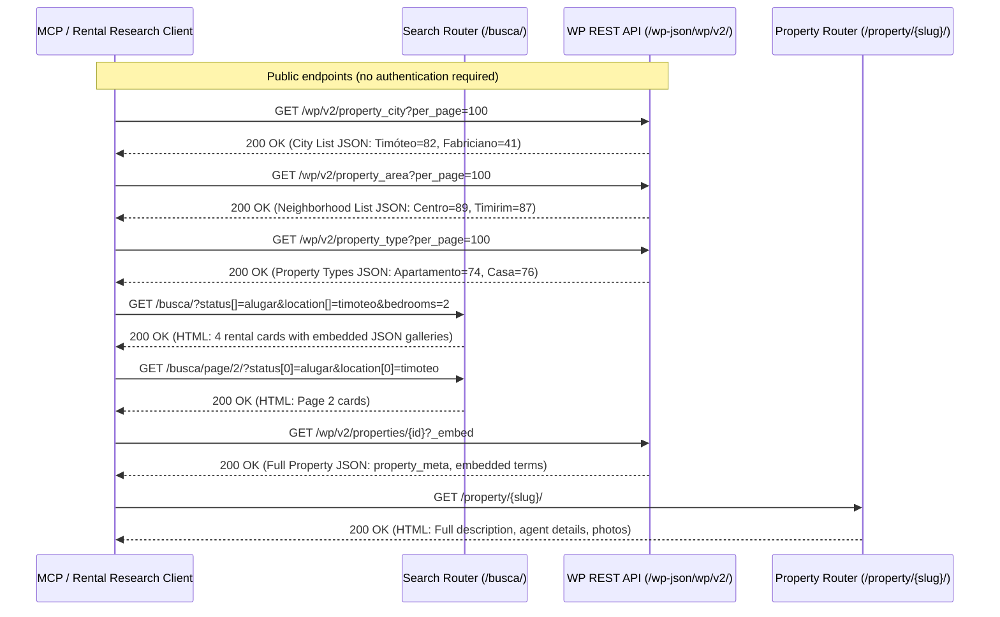

# Reverse-Engineered Rental Search API Documentation
**Target Domain**: `arthusoimoveis.com.br`  
**Focus**: Rental Search, Supporting Metadata (Filters), Pagination, and Property Detail Retrieval  
**Status**: Completely reverse-engineered, validated, and reproducible without authentication.

**TLS validation**: HTML and JSON requests use HTTPX's default certificate and hostname verification. Certificate validation failures surface as `HttpTransportError`; the client does not disable TLS verification.

---

## 1. System Overview & Architecture

Arthuso Imóveis runs on a WordPress CMS paired with the **Houzez** real estate theme (`wp-content/themes/houzez`) hosted on an Apache web server protected by Mod_Security.

The website provides two complementary mechanisms to query and retrieve rental data:
1. **Frontend Search Endpoint (`GET /busca/`)**: The primary search interface rendering property listing cards (`.item-listing-wrap`) containing embedded image gallery JSON, property IDs, pricing, and amenities.
2. **WordPress REST API (`GET /wp-json/wp/v2/`)**: Open, unauthenticated REST API exposing rich JSON schemas for properties, media attachments, and taxonomies (cities, neighborhoods, property types, statuses).



### Key Architectural Findings:
1. **Server-Side Rendered Search Cards with Embedded JSON**: Unlike single-page AJAX listings, `/busca/` renders listings directly in the initial HTML. Each card (`.item-listing-wrap`) includes a `data-images` attribute containing the complete gallery of image URLs with dimensions in JSON format.
2. **Zero Authentication Required**: No API tokens, bearer headers, session cookies, or CSRF nonces are required for search, pagination, filter discovery, or property details.
3. **Mod_Security WAF Requirement**: The Apache server runs Mod_Security. Automated clients MUST transmit standard browser headers (`User-Agent` and `Accept-Language: pt-BR,pt;q=0.9,en-US;q=0.8,en;q=0.7`) to prevent HTTP 406 "Not Acceptable" rejections.
4. **Canonical 301 Normalization**: Query-parameter pagination (`?paged=2`) is redirected via HTTP 301 to path-based pagination (`/busca/page/2/`). Furthermore, array parameter keys (`status[]`) are normalized to indexed keys (`status[0]`) on paginated subpaths.

---

## 2. Target URL Deconstruction

**Target URL**:
```text
https://arthusoimoveis.com.br/busca/?status%5B%5D=alugar&property_id=&keyword=&location%5B%5D=timoteo&areas%5B%5D=&bedrooms=2&max-price=
```

### Query Parameter Breakdown
| Parameter | Value in Target URL | Internal Meaning | Supported Alternatives |
|---|---|---|---|
| `status[]` | `alugar` | Transaction purpose (Rental) | `comprar`, `alugado-vendido` |
| `property_id` | *(empty)* | Property reference code | e.g. `1134`, `1135`, `929` |
| `keyword` | *(empty)* | Free-text keyword search | Address, title, or description words |
| `location[]` | `timoteo` | City slug | `cel-fabriciano`, `ipatinga`, `cava-grande` |
| `areas[]` | *(empty)* | Neighborhood / Bairro slug | `centro`, `timirim`, `santa-maria`, `serenata` |
| `type[]` | *(omitted)* | Property type slug | `apartamento`, `casa`, `comercial`, `galpao` |
| `bedrooms` | `2` | Number of bedrooms | `1`, `2`, `3`, `4`, `5` |
| `bathrooms` | *(omitted)* | Number of bathrooms | `1`, `2`, `3`, `4` |
| `min-price` | *(omitted)* | Minimum rental price (BRL) | Numeric string e.g. `1000` |
| `max-price` | *(empty)* | Maximum rental price (BRL) | Numeric string e.g. `2500` |
| `min-area` | *(omitted)* | Minimum area in m² | Numeric string e.g. `60` |
| `max-area` | *(omitted)* | Maximum area in m² | Numeric string e.g. `200` |
| `sortby` | *(omitted)* | Sorting order | `a_price`, `d_price`, `d_date`, `a_date` |

---

## 3. Detailed Endpoint Catalog

### 3.1. Primary Search Endpoints

#### `GET /busca/`
Executes search based on query parameters and returns page 1 of results.
- **URL**: `https://arthusoimoveis.com.br/busca/`
- **Method**: `GET`
- **Required Headers**:
  - `User-Agent`: `Mozilla/5.0 (X11; Linux x86_64) AppleWebKit/537.36 (KHTML, like Gecko) Chrome/128.0.0.0 Safari/537.36`
  - `Accept`: `text/html,application/xhtml+xml,application/xml;q=0.9,*/*;q=0.8`
  - `Accept-Language`: `pt-BR,pt;q=0.9,en-US;q=0.8,en;q=0.7`
- **Example Request**:
  ```text
  GET /busca/?status%5B0%5D=alugar&location%5B0%5D=timoteo&bedrooms=2 HTTP/1.1
  Host: arthusoimoveis.com.br
  User-Agent: Mozilla/5.0 (X11; Linux x86_64) AppleWebKit/537.36 ...
  Accept-Language: pt-BR,pt;q=0.9,en-US;q=0.8,en;q=0.7
  ```
- **HTML Response Structure**:
  - Container: `<div class="listing-view list-view card-deck">`
  - Property card: `<div class="item-listing-wrap hz-item-gallery-js card" data-hz-id="hz-{id}" data-images='[...]'>`
  - Card attributes:
    - Post ID: `data-listid="{id}"` and `data-hz-id="hz-{id}"`
    - Embedded photos: `data-images='[{"image":"url","alt":"","width":592,"height":444},...]'`
    - Title: `.item-title a`
    - Link: `.item-title a['href']`
    - Price: `.item-price` (e.g. `R$ 950,00`)
    - Bedrooms: `.h-beds .hz-figure`
    - Bathrooms: `.h-baths .hz-figure`
    - Type: `.h-type span`
    - Date: `.item-date`

#### `GET /busca/page/{page}/`
Retrieves paginated search results for page numbers `2, 3, ...`.
- **URL**: `https://arthusoimoveis.com.br/busca/page/{page}/`
- **Method**: `GET`
- **Query Parameters**: Same query parameters as `/busca/`.
- **Behavior**:
  - Page size: 9 properties per page.
  - Beyond last page (e.g. page 6 when total is 38): Returns HTTP 200 with 0 `.item-listing-wrap` cards.
  - Query parameter `?paged=2` issues HTTP 301 redirect to `/busca/page/2/?...`.

---

### 3.2. WordPress REST API Search & Properties Endpoints

#### `GET /wp-json/wp/v2/properties`
Provides structured JSON querying of all real estate listings.
- **URL**: `https://arthusoimoveis.com.br/wp-json/wp/v2/properties`
- **Method**: `GET`
- **Query Parameters**:
  - `property_status`: Taxonomy ID (`3` for Alugar, `4` for Comprar)
  - `property_city`: Taxonomy ID (`82` for Timóteo, `41` for Fabriciano)
  - `property_area`: Taxonomy ID (e.g. `89` for Centro)
  - `property_type`: Taxonomy ID (e.g. `74` for Apartamento, `76` for Casa)
  - `per_page`: Number of results (1 to 100, default 10)
  - `page`: Page number (1-indexed)
  - `slug`: Exact post slug query
  - `search`: Keyword string
  - `order`: `asc` or `desc`
  - `orderby`: `date`, `id`, `title`, `slug`, `modified`
  - `_embed`: Resolves embedded taxonomy names, authors, and media
- **Response Headers**:
  - `X-WP-Total`: Total count of matched properties across database
  - `X-WP-TotalPages`: Total page count
- **Sample JSON Response**:
  ```json
  [
    {
      "id": 39790,
      "date": "2026-09-23T11:45:00",
      "slug": "apartamento-disponivel-para-locacao-no-centro-norte-timoteo",
      "link": "https://arthusoimoveis.com.br/property/apartamento-disponivel-para-locacao-no-centro-norte-timoteo/",
      "title": {
        "rendered": "Apartamento disponível para locação no Centro Norte, Timóteo,"
      },
      "property_meta": {
        "fave_property_price": ["950"],
        "fave_property_bedrooms": ["2"],
        "fave_property_bathrooms": ["1"],
        "fave_property_garage": ["1"],
        "fave_property_id": ["1134"],
        "fave_property_location": ["25.68654,-80.431345,15"],
        "houzez_geolocation_lat": ["25.68654"],
        "houzez_geolocation_long": ["-80.431345"],
        "fave_property_images": ["39791", "39792", "39793"]
      },
      "property_type": [74],
      "property_status": [3],
      "property_city": [82],
      "property_area": [89]
    }
  ]
  ```

---

### 3.3. Filter & Taxonomy Discovery Endpoints

All taxonomy endpoints support `per_page=100` and return structured terms:

#### `GET /wp-json/wp/v2/property_status`
- Status terms:
  - `id: 3`, `name: "Alugar"`, `slug: "alugar"`, `count: 60`
  - `id: 4`, `name: "Comprar"`, `slug: "comprar"`, `count: 562`
  - `id: 84`, `name: "Alugado/Vendido"`, `slug: "alugado-vendido"`, `count: 4`

#### `GET /wp-json/wp/v2/property_city`
- Key cities:
  - `id: 82`, `name: "Timóteo"`, `slug: "timoteo"`, `count: 346`
  - `id: 41`, `name: "Coronel Fabriciano"`, `slug: "cel-fabriciano"`, `count: 186`
  - `id: 27`, `name: "Ipatinga"`, `slug: "ipatinga"`, `count: 23`
  - `id: 98`, `name: "Cava Grande"`, `slug: "cava-grande"`, `count: 14`

#### `GET /wp-json/wp/v2/property_area`
- Key Timóteo neighborhoods:
  - `id: 89`, `name: "Centro"`, `slug: "centro"`, `count: 45`
  - `id: 87`, `name: "Timirim"`, `slug: "timirim"`, `count: 14`
  - `id: 91`, `name: "Serenata"`, `slug: "serenata"`, `count: 21`
  - `id: 119`, `name: "Santa Maria"`, `slug: "santa-maria"`, `count: 16`
  - `id: 94`, `name: "Quitandinha"`, `slug: "quitandinha"`, `count: 13`
  - `id: 109`, `name: "Alto Primavera"`, `slug: "alto-primavera"`, `count: 18`

#### `GET /wp-json/wp/v2/property_type`
- Property types:
  - `id: 74`, `name: "Apartamento"`, `slug: "apartamento"`, `count: 217`
  - `id: 76`, `name: "Casa"`, `slug: "casa"`, `count: 228`
  - `id: 29`, `name: "Comercial"`, `slug: "comercial"`, `count: 48`
  - `id: 61`, `name: "Loja"`, `slug: "loja"`, `count: 36`
  - `id: 62`, `name: "Duplex"`, `slug: "duplex"`, `count: 56`
  - `id: 75`, `name: "Cobertura"`, `slug: "cobertura"`, `count: 50`

---

### 3.4. Property Detail Endpoints

#### `GET /wp-json/wp/v2/properties/{id}?_embed`
Retrieves full details for a property by its WordPress post ID.
- Includes `content.rendered` (full description HTML).
- Includes embedded taxonomy objects in `_embedded['wp:term']`.
- Includes `property_meta` with code `fave_property_id`, prices, garage, and coordinates.

#### `GET /wp-json/wp/v2/properties?slug={slug}&_embed`
Retrieves full details for a property given its permalink slug.

#### `GET /wp-json/wp/v2/media?include={id1},{id2},...`
Retrieves direct source URLs and thumbnail sizes for property image attachments.

#### Web Fallback: `GET /property/{slug}/`
Returns full HTML view of the property with high-resolution image gallery, agency contact details, and formatted amenities list.

---

### 3.5. Autocomplete Search Endpoint

#### `POST /wp-admin/admin-ajax.php`
- **Method**: `POST`
- **Payload**: `action=houzez_get_auto_complete_search&key={query}`
- **Headers**: Mandatory `X-Requested-With: XMLHttpRequest`, `Origin: https://arthusoimoveis.com.br`, `Referer: https://arthusoimoveis.com.br/`, standard browser `User-Agent` and `Accept-Language`.
- **Response**: HTML dropdown containing `<li class="list-group-item" data-text="{code}">...</li>`.

---

## 4. Pagination & Slicing Behavior

1. **Fixed Page Size**:
   - The web frontend search operates with a fixed size of **9 items per page**.
   - The REST API defaults to 10 items per page and supports up to **100 items per page** (`per_page=100`).
2. **Total Listings**:
   - For all rentals in Timóteo (`status[]=alugar&location[]=timoteo`), there are currently **38 active listings**.
   - Page 1: items 1–9.
   - Page 2: items 10–18.
   - Page 3: items 19–27.
   - Page 4: items 28–36.
   - Page 5: items 37–38 (2 items).
   - Page 6+: 0 items returned cleanly.
3. **Target Filter Execution (`bedrooms=2`)**:
   - Filtering for 2 bedrooms in Timóteo narrows the results to exactly **4 listings**.
   - Fits on a single page (Page 1 has 4 listings; Page 2 has 0 listings).

---

## 5. Security & Mod_Security WAF Analysis

### Vulnerability to Mod_Security Blocking
The Apache server intercepts incoming requests with Mod_Security rules. The following failure modes were empirically confirmed:
- Sending a generic bot User-Agent (e.g. `python-httpx/0.28.1` or `Mozilla/5.0` without platform tokens) causes `HTTP 406 Not Acceptable`.
- Omitting the `Accept-Language` header causes `HTTP 406 Not Acceptable`.

### Mandatory Client Headers
Every request emitted by the Python module MUST include:
```python
DEFAULT_HEADERS = {
    "User-Agent": "Mozilla/5.0 (X11; Linux x86_64) AppleWebKit/537.36 (KHTML, like Gecko) Chrome/128.0.0.0 Safari/537.36",
    "Accept": "text/html,application/xhtml+xml,application/xml;q=0.9,image/avif,image/webp,image/apng,*/*;q=0.8,application/json",
    "Accept-Language": "pt-BR,pt;q=0.9,en-US;q=0.8,en;q=0.7",
}
```

---

## 6. MCP Module Boundary Design

The reverse-engineered functionality is organized into clean, reusable Python modules conforming to Object Calisthenics:

- **Domain Layer (`arthuso.domain`)**:
  - `primitives.py`: Strongly typed Value Objects with fail-fast validation (`PropertyId`, `PropertyCode`, `RentalPrice`, `CitySlug`, `NeighborhoodSlug`, `PropertyTypeSlug`, `TransactionStatus`, `BedroomCount`, `BathroomCount`, `PageNumber`, `SortOrder`).
  - `models.py`: Composite data models (`PropertySummary`, `PropertyDetail`, `SearchCriteria`, `PaginationSpec`, `TaxonomyTerm`).
  - `collections.py`: First-class collections (`PropertyCollection`, `CityCollection`, `NeighborhoodCollection`, `PropertyTypeCollection`).
  - `exceptions.py`: Domain exception hierarchy (`ArthusoError`, `ValidationError`, `PropertyNotFoundError`, `HttpTransportError`, `ParsingError`).
- **Infrastructure Layer (`arthuso.infrastructure`)**:
  - `endpoints.py`: URL endpoints and constants.
  - `http_transport.py`: Encapsulates HTTP execution with browser header injection, timeout handling, and redirect following.
  - `query_builder.py`: Formats search criteria into valid GET query parameters and paginated URL paths.
  - `html_parser.py`: Robust HTML card extractor for `.item-listing-wrap`.
  - `deserializer.py`: Deserializes JSON REST responses into domain entities.
- **Application Layer (`arthuso.application`)**:
  - `interfaces.py`: Port protocols (`RentalSearchPort`, `PropertyDetailPort`, `FilterCatalogPort`).
  - `url_parser.py`: Parses any search URL into typed `SearchCriteria`.
  - `service.py`: `RentalResearchService`, the primary facade implementing the MCP boundary.
