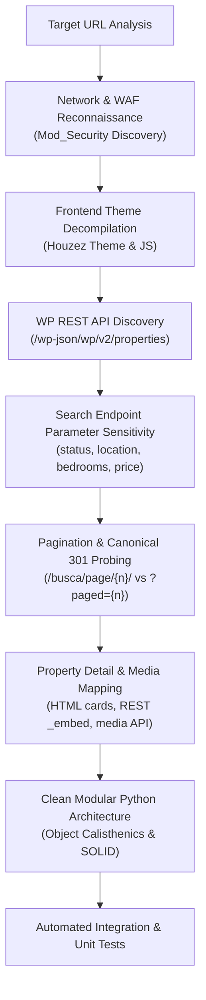

# Rental Search API Reverse-Engineering Plan & Execution Log

## 1. Executive Summary & Objective

The objective of this research is to completely reverse-engineer the rental search workflow of **Arthuso Imóveis** (`arthusoimoveis.com.br`), focusing strictly on:
- The rental listing and search flow.
- Directly required supporting endpoints: filter discovery (cities, neighborhoods, property types, statuses), pagination behavior, and property detail retrieval.
- Verifying authentication and security requirements (confirmed: entirely public, unauthenticated, but protected by Apache Mod_Security requiring browser headers).

The end goal is to define and implement reusable Python modules following **SOLID**, **Clean Code**, **Object Calisthenics**, and **Design Patterns** (prioritizing: 1. correctness, 2. modularity, 3. style principles) serving as the core boundary interface for a central Rental Research Model Context Protocol (MCP).

Target Research URL:
```text
https://arthusoimoveis.com.br/busca/?status%5B%5D=alugar&property_id=&keyword=&location%5B%5D=timoteo&areas%5B%5D=&bedrooms=2&max-price=
```

---

## 2. Reverse-Engineering Methodology



The investigation proceeded in nine structured phases:

1. **Reconnaissance & WAF Profiling**:
   - Inspected HTTP response headers (`Server: Apache`, `Cache-Control: max-age=7200`, `X-Newfold-Cache-Level: 2`).
   - Triggered and analyzed HTTP 406 "Not Acceptable! This error was generated by Mod_Security".
   - Isolated strict header requirements: standard browser `User-Agent` and `Accept-Language` (`pt-BR,pt;q=0.9,en-US;q=0.8,en;q=0.7`) are mandatory to prevent WAF blocking.

2. **CMS & Theme Decompilation**:
   - Identified WordPress platform with the **Houzez** real estate theme (`wp-content/themes/houzez`).
   - Extracted global configuration object `var houzez_vars` from inline scripts.
   - Verified that `is_halfmap` is disabled; search results are server-rendered via WordPress query templates rather than client-only map AJAX calls.

3. **REST API Surface Discovery**:
   - Discovered full, unauthenticated WordPress REST API surface at `/wp-json/wp/v2/`.
   - Identified open taxonomy routes:
     - `GET /wp-json/wp/v2/property_status` (Alugar: ID 3, 60 properties; Comprar: ID 4, 562 properties).
     - `GET /wp-json/wp/v2/property_city` (Timóteo: ID 82, 346 properties; Cel. Fabriciano: ID 41, 186 properties).
     - `GET /wp-json/wp/v2/property_area` (100 neighborhoods: Centro: ID 89, Timirim: ID 87, Santa Maria: ID 119, etc.).
     - `GET /wp-json/wp/v2/property_type` (Apartamento: ID 74, Casa: ID 76, etc.).
   - Discovered core properties endpoint `GET /wp-json/wp/v2/properties` exposing `property_meta` and HATEOAS `_embed` links.

4. **Frontend Search Form Parameter Mapping**:
   - Analyzed search form `<form action="https://arthusoimoveis.com.br/busca/" method="get">`.
   - Mapped all input elements: `status[]`, `property_id`, `keyword`, `location[]`, `areas[]`, `type[]`, `bedrooms`, `bathrooms`, `min-price`, `max-price`, `min-area`, `max-area`, `sortby`.
   - Tested sensitivity of each parameter against server-rendered output.

5. **Pagination & Boundary Probing**:
   - Verified default page size of 9 listings per page in web search.
   - Identified canonical redirect: requests to `/busca/?status[]=alugar&location[]=timoteo&paged=2` return HTTP 301 redirecting to `/busca/page/2/?status[0]=alugar&location[0]=timoteo`.
   - Validated boundary conditions for Timóteo rentals (38 total listings):
     - Page 1 to Page 4: 9 listings each (36 listings).
     - Page 5: 2 listings (reaching exactly 38 listings).
     - Page 6: 0 listings (graceful empty result).

6. **Filter Mechanics Validation**:
   - Verified `bedrooms=2` filter on Timóteo rentals isolates exactly 4 properties.
   - Verified price sorting (`sortby=a_price` for lowest price first, `sortby=d_price` for highest price first).
   - Verified minimum and maximum price threshold filtering (`min-price`, `max-price`).
   - Verified neighborhood filtering using slug values (`areas[]=centro`).

7. **Property Detail Investigation**:
   - Deconstructed web listing cards (`.item-listing-wrap`):
     - Embeds full JSON image gallery in `data-images` attribute directly on the search card.
     - Contains post ID in `data-listid` and `data-hz-id`.
     - Contains price, title, permalink, bedroom count, bathroom count, property type, and relative posting date.
   - Validated REST detail retrieval:
     - `GET /wp-json/wp/v2/properties/{id}?_embed` resolves embedded taxonomy names and full metadata.
     - `GET /wp-json/wp/v2/properties?slug={slug}&_embed` resolves properties by slug.
     - `GET /wp-json/wp/v2/media?include={id1},{id2}` retrieves direct image source URLs.

8. **Auth & Security Evaluation**:
   - Confirmed no login credentials, sessions, or API tokens are required.
   - Confirmed Mod_Security WAF requires browser header compliance across all automated requests.

9. **Modular Architecture & Test Matrix Implementation**:
   - Encapsulated the findings into reusable Python modules following Object Calisthenics:
     - Primitive wrapping (`PropertyCode`, `RentalPrice`, `CitySlug`, `NeighborhoodSlug`, `BedroomCount`, `PageNumber`, etc.).
     - Classes with at most 2 instance variables.
     - Methods <= 15 lines, classes <= 100 lines, modules <= 200 lines.
     - Guard clauses with early returns, zero `else` statements.
     - One dot per line.
   - Authored unit and live integration tests.

---

## 3. Empirical Test Matrix & Verification Log

| Test Case ID | Target Tested | Request / Action | Expected Result | Observed Result | Status |
|---|---|---|---|---|---|
| TC-01 | WAF Header Sensitivity | `GET /busca/` with default non-browser User-Agent | Mod_Security 406 rejection | HTTP 406 Not Acceptable | PASS |
| TC-02 | WAF Header Bypass | `GET /busca/` with Chrome User-Agent & Accept-Language | HTTP 200 OK | HTTP 200 OK | PASS |
| TC-03 | Baseline Rental Search | `GET /busca/?status%5B0%5D=alugar&location%5B0%5D=timoteo` | Page 1 returns 9 rental items | Status 200, exactly 9 cards parsed | PASS |
| TC-04 | Target URL Reproduction | `GET /busca/?status%5B%5D=alugar&property_id=&keyword=&location%5B%5D=timoteo&areas%5B%5D=&bedrooms=2&max-price=` | 4 matching 2-bedroom rental listings | Status 200, exactly 4 cards parsed | PASS |
| TC-05 | Pagination Page 2 | `GET /busca/page/2/?status%5B0%5D=alugar&location%5B0%5D=timoteo` | Next 9 rental listings | Status 200, 9 cards parsed, active page 2 | PASS |
| TC-06 | Boundary Pagination | `GET /busca/page/5/` vs `GET /busca/page/6/` | Page 5 has 2 items; Page 6 has 0 items | Status 200, 2 items on p.5, 0 on p.6 | PASS |
| TC-07 | Canonical 301 Redirect | `GET /busca/?status%5B%5D=alugar&paged=2` | HTTP 301 to `/busca/page/2/?...` | Status 301 with normalized query | PASS |
| TC-08 | Price Ascending Sort | `GET /busca/?status%5B0%5D=alugar&location%5B0%5D=timoteo&sortby=a_price` | Lowest prices first | Status 200, ordered from R$ 600,00 | PASS |
| TC-09 | City Filter REST API | `GET /wp-json/wp/v2/property_city?per_page=100` | List of 16 cities including Timóteo (ID 82) | Status 200, 16 cities parsed | PASS |
| TC-10 | Area Filter REST API | `GET /wp-json/wp/v2/property_area?per_page=100` | List of neighborhoods | Status 200, 100 areas parsed | PASS |
| TC-11 | REST Search & Totals | `GET /wp-json/wp/v2/properties?property_status=3&property_city=82` | Total 38 properties via `X-WP-Total` | Status 200, `X-WP-Total: 38` | PASS |
| TC-12 | Property Detail REST | `GET /wp-json/wp/v2/properties/39823?_embed` | Full metadata and embedded taxonomies | Status 200, code 1135, price 3500 | PASS |

---

## 4. Central Rental Research MCP Boundary Interface

The reverse-engineered components are encapsulated into a high-cohesion module structure suitable for direct import into an MCP server or client tool:

- **Domain Layer** (`arthuso.domain`):
  - `primitives.py`: Value objects validating domain constraints (`PropertyCode`, `RentalPrice`, `CitySlug`, `NeighborhoodSlug`, `PropertyTypeSlug`, `TransactionStatus`, `BedroomCount`, `BathroomCount`, `PageNumber`, `SortOrder`).
  - `models.py`: Composite entities (`PropertySummary`, `PropertyDetail`, `SearchCriteria`, `PaginationSpec`, `TaxonomyTerm`).
  - `collections.py`: First-class collections (`PropertyCollection`, `CityCollection`, `NeighborhoodCollection`, `PropertyTypeCollection`).
  - `exceptions.py`: Explicit domain exception hierarchy (`ArthusoError`, `ValidationError`, `PropertyNotFoundError`, `HttpTransportError`, `ParsingError`).
- **Infrastructure Layer** (`arthuso.infrastructure`):
  - `endpoints.py`: Centralized URLs, default headers, and parameter mapping constants.
  - `http_transport.py`: Robust HTTP communication client with Mod_Security header compliance, timeout, and redirect handling.
  - `query_builder.py`: Translates high-level domain criteria into wire-format GET query parameters and paginated URL paths.
  - `html_parser.py`: Robust BeautifulSoup parser for `.item-listing-wrap` cards and pagination bars.
  - `deserializer.py`: Transforms raw JSON responses and HTML cards into rich domain models.
- **Application Layer** (`arthuso.application`):
  - `interfaces.py`: Clean abstract contracts (`RentalSearchPort`, `PropertyDetailPort`, `FilterCatalogPort`).
  - `service.py`: `RentalResearchService`, the primary facade implementing the MCP boundary.
  - `url_parser.py`: Reverse-engineers frontend search URLs directly into typed `SearchCriteria` and `PaginationSpec`.
